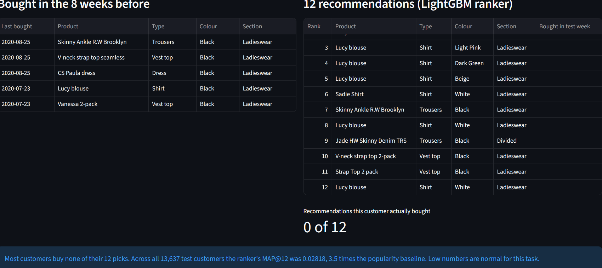
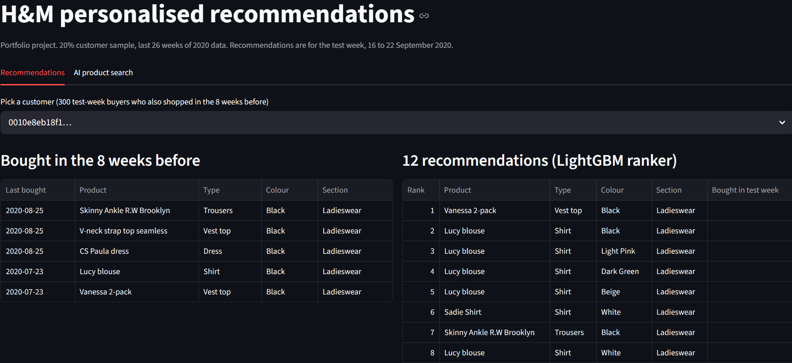

# H&M fashion recommendations and AI product search

I built a weekly recommender for H&M: for each customer, guess the 12 products they'll buy next week. I also built a search box where you describe what you want in plain words and get real products back. The whole thing runs on a laptop with 16 GB of RAM and no GPU.

**Main result:** my LightGBM ranker scored MAP@12 = 0.02818 on the final test week, **3.5 times** the popularity baseline and **14% better** than my best hand-made rule. I also tried a two-tower neural network. It didn't beat the simple methods, and I explain why below.

## The data
[H&M Personalized Fashion Recommendations](https://www.kaggle.com/competitions/h-and-m-personalized-fashion-recommendations) on Kaggle: 1.37 million customers, 105,542 products and 31.8 million purchases from September 2018 to September 2020. To fit my laptop, I used a random 20% of customers (274,259 people) and their last 26 weeks of purchases (1.6 million rows). I checked that the sample matched the full data on age, shopping frequency and the share of one-time buyers. The data isn't included in this repo, because Kaggle's rules don't allow sharing it.

## How I approached it
I split the data by time, never at random, so no model ever sees the future. I tuned everything on one validation week (9 to 15 Sep 2020) and scored the final test week (16 to 22 Sep) only once, at the very end. Every method is compared against a popularity baseline, and I used paired bootstrap tests to check whether a gain is real or just luck.

| Notebook | What it does |
|---|---|
| 01–02 | Convert CSVs to Parquet, data quality checks |
| 03 | EDA with SQL (DuckDB) and a chi-square test |
| 04–05 | Customer sample and time-based split |
| 06 | Popularity, "bought before" and "bought together" |
| 07 | Text embeddings with sentence-transformers |
| 08 | Two-tower neural recommender in PyTorch |
| 09 | LightGBM ranker and the final test |
| 10 | AI product search (retrieval + Gemini) and its evaluation |
| 11 | Cold start for new customers |
| 12 | Weekly drift check |
| 13 | A/B test plan |

## Results on the test week

| Method | MAP@12 | vs popularity |
|---|---|---|
| Popularity, last 2 weeks | 0.00794 | 1.0x |
| Past purchases, last 8 weeks | 0.02412 | 3.0x |
| + bought together | 0.02472 | 3.1x |
| **LightGBM ranker** | **0.02818** | **3.5x** |

The ranker beat my best simple method by +0.00346 (95% bootstrap range +0.00232 to +0.00472), and 953 customers were better off against 582 worse off. Its validation score (0.02827) was almost the same, so I don't think I overfitted. The most important features were how recently the customer bought that exact item (35% of the gain), how recently they shopped at all (15%) and bought-together strength (13%).

These numbers look tiny, and that's normal for this task. A typical buyer bought only 2 items in a week, and only about 5% of customers buy anything in a given week.

## What didn't work
- **Two-tower model (PyTorch).** It clearly learned (the loss fell from 6.9 to 4.7), but its picks never beat the simple methods. Adding them after a customer's past purchases always lowered the score. I think 121,834 training examples is too few for this kind of model, and in-batch training doesn't learn how popular an item is, which turned out to matter a lot. I stopped after one fair tuning round rather than tuning until something looked good.
- **Text embeddings on their own** helped a little (+0.00053), but less than the simple bought-together count, and more customers got worse than better.
- **Age-based picks for new customers** scored 15% higher, but the confidence interval included zero, so I didn't switch them on.

## AI product search
You type something like "warm winter jacket for men". A sentence-transformer finds the 20 closest products among 35,576 items currently on sale, then Gemini picks the best matches **from only those 20**, so it can't invent products.

I tested this on 16 requests with strict rules I wrote in advance:
- Retrieval alone: mean precision@5 of 0.77. It was good at the type of item but often ignored colour or men/women.
- Gemini's picks: 95% correct.
- Grounding: in **16 out of 16** cases, every product came from the retrieved list.
- For 2 requests H&M can't serve (a laptop charger and a lawn mower), it correctly recommended nothing.

One lesson: the "warm winter jacket for men" query scored 0.5 because one pick, the Peter downfree jacket, is labelled "Unknown" type in H&M's data. It's clearly a men's jacket. My test rule was stricter than the data is clean.

## Production thinking
- **Cold start:** customers with no history get best-sellers from the last 2 weeks. About 18% of scored customers fall into this group.
- **Drift:** I re-ran the simple methods over 13 weeks. Popularity swung by 4.4x between its best and worst week, while the personal method stayed within 1.34x and beat popularity every week. My test week was about 14% better than average, so a typical week would likely score lower. A simple alert (a drop of more than 20% vs the previous 4 weeks) fired once, right before what people bought shifted.
- **A/B test:** offline MAP@12 doesn't prove more sales. I wrote a test plan (main metric, guardrails, sample size, at least 2 weeks) in notebook 13. It's designed but not run.
- **Model card:** [MODEL_CARD.md](MODEL_CARD.md) covers purpose, data, results and limits.

## Limits
- Only about 8% of real purchases were in the shortlist of ~50 candidates, which caps what any ranker can do. Better candidate generation would probably help more than a fancier model.
- The ranker sometimes recommends the same product in several colours, because H&M stores each colour as a separate item.
- Everything is offline, on a 20% sample over 26 weeks. Prices are scaled by H&M, so nothing here says anything about real revenue.
- During my search evaluation the main Gemini model was overloaded, so all answers came from the lighter fallback model.

## Run it yourself
1. Accept the competition rules on Kaggle and download `articles.csv`, `customers.csv` and `transactions_train.csv` into `data/`.
2. `pip install -r requirements.txt`
3. Put a Gemini API key in a `.env` file: `GEMINI_API_KEY=your_key`
4. Run the notebooks in order (01 to 13).
5. `python -m streamlit run app.py`

Tools: Python, DuckDB (SQL), pandas, scikit-learn, LightGBM, PyTorch, sentence-transformers, Gemini API, Streamlit.
